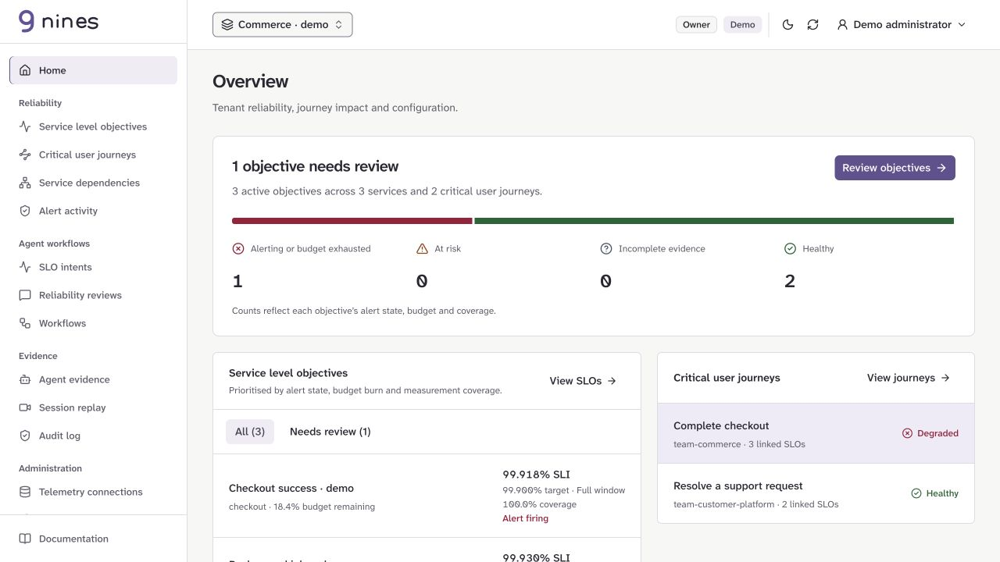

<picture>
  <source media="(prefers-color-scheme: dark)" srcset="docs/public/brand/nines-dark.svg">
  
</picture>

# Nines

Service level objectives and critical user journeys as versioned YAML, with a portal, CLI, Go client, Kubernetes operator and optional agent workflows.

- **Measure reliability:** connect Prometheus or Mimir (or try experimental [Datadog, New Relic, VictoriaMetrics, Dash0 and Google Cloud collection](docs/public/provider-adapters.md)) and inspect SLI attainment, coverage, error budgets and burn alerts.
- **Publish reviewed objectives:** create native [Datadog](docs/public/provider-adapters.md#publish-a-native-datadog-slo), [New Relic](docs/public/new-relic.md), [Dash0](docs/public/dash0.md) or [Google Cloud](docs/public/google-cloud.md) SLOs within their supported subsets. Native burn-monitor publishing remains separate.
- **Map user outcomes:** link SLOs to critical user journey steps and service dependencies.
- **Review changes:** plan, approve and apply exact revisions, with audit records and separately reviewed rollback.
- **Work with agents:** use provider-configurable models, deterministic CLI skills and tenant-scoped MCP tools over stdio or opt-in [remote OAuth HTTP](docs/public/remote-mcp.md).
- **Run it yourself:** use native binaries, Docker Compose or Kubernetes.

**Pre-release MVP, under active development.** APIs use `nines.dev/v1alpha1` and may change. Model-assisted workflows, visual evaluations and session replay are experimental; production-scale readiness has not been established.

<a href="docs/public/brand/nines-overview.jpg">
  
</a>

*Synthetic demo workspace. [View the full-size screenshot](docs/public/brand/nines-overview.jpg).*

## Try the demo

1. Clone the repository and enter it:

   ```sh
   git clone https://github.com/ishantanu/nines.git
   cd nines
   ```

2. Start the in-memory demo with Go 1.27.3 or later:

   ```sh
   go run ./cmd/server -demo
   ```

3. Open [localhost:8080](http://127.0.0.1:8080) and sign in with **admin / admin**.

- Includes synthetic SLOs, critical user journeys and critical/warning burn policies.
- Resets on restart; keep this demonstration on loopback.
- Node is not required to run the committed UI build.

## Provider support

- **Prometheus / Mimir:** collection, discovery, recording and burn-rate rules; portal or tenant-file configuration.
- **Datadog / New Relic:** experimental collection, reviewed native SLO publication, on-demand native results and reviewed YAML import drafts; portal or tenant-file configuration.
- **Dash0:** experimental collection and native OpenSLO publication; configure publication in the tenant file.
- **Google Cloud Monitoring:** experimental DELTA-count collection and native SLO publication; tenant-file configuration with ADC or an access token.
- **VictoriaMetrics:** experimental interval-count collection; tenant-file configuration.
- Provider symbols beside SLOs identify the telemetry connection. Native publication has separate review and verification evidence; native vendor alert creation is not included.
- See the [support matrix, query validation and acceptance limits](https://ishantanu.github.io/nines/docs/provider-adapters/).

## Test Prometheus locally

1. Start with Docker Compose v2 and Python 3 available. The launcher creates a private `.env` on first use and preserves existing credentials:

   ```sh
   ./playground up
   ```

2. Open [localhost:18080](http://localhost:18080), sign in with **admin / admin**, and select **Playground Prometheus**.
3. Run the optional end-to-end verifier; allow several minutes:

   ```sh
   ./playground verify
   ```

- Add options once: `./playground up --mimir --jev`, `--ai`, `--topology` or `--providers /private/path/tenants.yaml`. Subsequent commands remember the selection.
- Use `./playground logs`, `./playground status` and `./playground down`. Shutdown preserves data.

- Includes PostgreSQL, Prometheus and a synthetic checkout service.
- Automatically deploys the sample SLO's recording and alert rules.
- Verifies collection, rule evaluation, critical/warning firing and recovery, users and RBAC.
- Optional profiles: [Mimir](https://ishantanu.github.io/nines/docs/deployment/playground/#optional-mimir-profile), [AI workloads](https://ishantanu.github.io/nines/docs/deployment/ai-playground/) and [Jev advice](https://ishantanu.github.io/nines/docs/deployment/playground/#optional-jev-advice).
- Follow the [playground guide](https://ishantanu.github.io/nines/docs/deployment/playground/) for queries, troubleshooting and shutdown.

## Login credentials

- **In-memory demo:** `admin` / `admin` at `localhost:8080`.
- **Playground:** `admin` / `admin` at `localhost:18080`, unless `NINES_PLAYGROUND_PASSWORD` was set before first startup.
- **Persistent Compose:** `admin` and your private `NINES_BOOTSTRAP_PASSWORD` from `.env`; no fixed web password.
- **Database:** `POSTGRES_PASSWORD` is required through `.env` or the environment. It is separate from the web password and API credentials.
- **Existing data:** bootstrap variables do not reset retained account passwords. Use **Access control → Users** to change a known password.

## Use the CLI without a server

```sh
make cli
bin/nines init slo --name checkout --window 28d --out checkout.yaml
bin/nines validate --offline -f checkout.yaml --agent
bin/nines rules generate --offline -f checkout.yaml --tenant commerce
bin/nines capabilities --offline --agent
```

- Keep the measurement, target, window and alert policies in one SLO definition.
- Start from the [availability](examples/request-success.slo.yaml) or [latency](examples/request-latency.slo.yaml) example; no separate measurement binding is required.
- Validation checks the contract; it does not verify that telemetry exists or measures the intended outcome.
- Offline rule generation writes YAML. Deployment requires a configured server route, provider reload or operator.
- Use `-f -` for stdin and `--agent` for structured automation output. See the [CLI guide](https://ishantanu.github.io/nines/docs/cli/).

## Run a persistent workspace

```sh
python3 scripts/setup-local.py
docker compose -p nines up --build -d
```

- Open [localhost:8080](http://127.0.0.1:8080); sign in as `admin` with `NINES_BOOTSTRAP_PASSWORD` from the generated private `.env`.
- PostgreSQL data persists in its own volume.
- Manage tenant users and roles under **Access control**; configure OIDC/Microsoft Entra or LDAP through server-owned identity settings.
- For native execution, supply `DATABASE_URL` and `API_TOKEN` through the environment; the binary does not automatically load `.env`.

Connect the CLI with an API key or configured SSO:

```sh
bin/nines config set-context production --server https://nines.example.com --tenant commerce
# Set NINES_API_KEY privately, or sign in through configured SSO:
bin/nines login --context production --method sso
bin/nines get slos --context production --agent
bin/nines plan --context production -f reviewed.yaml --agent
bin/nines apply --context production -f reviewed.yaml --expected-revision 0 --agent
```

- The server enforces tenant membership and roles for every connected client.
- `API_TOKEN` remains an alias for API-key authentication.
- Use the [deployment guides](https://ishantanu.github.io/nines/docs/deployment/) for Compose, Linux, Kubernetes and the standalone operator.

## First-release scope

- **Definitions:** revisioned SLOs, critical user journeys and explicit journey-step links in YAML.
- **Measurement:** event ratios, provider windows, configurable rolling windows, quality checks, cohorts and error budgets.
- **Alerts and rules:** up to eight named severity-based burn policies; Prometheus files/reload, Mimir ruler or Kubernetes operator destinations.
- **Change control:** exact-revision review/apply, audit history, archival and separately reviewed rollback. Configuration rollback cannot restore consumed budget.
- **Dependencies:** visual service maps, offline Kubernetes imports and optional namespace-scoped discovery with review.
- **Identity:** local accounts, API/service-account keys, OIDC/LDAP, tenant roles, teams and a separate platform admin console.
- **Clients:** tenant-aware portal, offline/connected Cobra CLI, typed Go client and stdio MCP adapter.
- **Operator:** standalone GitOps reconciliation, namespaced RBAC, lease-based standby and generation-scoped provider diagnostics.
- **Extensions:** built-in, file, HTTPS and commit-pinned Git templates render ordinary YAML without executing runtime code.
- **Experimental:** model-assisted intents, Jev advice, agent/LLM/inference templates and session replay. Models are optional, including local providers.

See [supported limits](https://ishantanu.github.io/nines/docs/operations/), [experimental features](https://ishantanu.github.io/nines/docs/experimental/) and [verification evidence](https://ishantanu.github.io/nines/docs/verification/).

## Alpha binaries

- Download Linux/macOS amd64/arm64 archives from [GitHub Releases](https://github.com/ishantanu/nines/releases).
- Archives contain the CLI, server, MCP adapter, operator, examples and dependency licences.
- Verify `SHA256SUMS` and the source commit in `build.json`.
- Read the [release process](https://ishantanu.github.io/nines/docs/release/#tag-based-alpha-binaries) before publishing tags.

## Documentation

Start with the [hosted documentation](https://ishantanu.github.io/nines/docs/).

- **Define:** [measurements](https://ishantanu.github.io/nines/docs/measurements/), [templates and SLI menus](https://ishantanu.github.io/nines/docs/slo-templates/), [critical user journeys](https://ishantanu.github.io/nines/docs/critical-user-journeys/).
- **Connect:** [Prometheus/Mimir and rule deployment](https://ishantanu.github.io/nines/docs/deployment/metrics-and-rules/), [Kubernetes operator](https://ishantanu.github.io/nines/docs/deployment/operator/).
- **Operate:** [measurement quality](https://ishantanu.github.io/nines/docs/measurement-quality/), [error-budget policies](https://ishantanu.github.io/nines/docs/error-budget-policy/), [service dependencies](https://ishantanu.github.io/nines/docs/service-dependencies/).
- **Change safely:** [SLO editing](https://ishantanu.github.io/nines/docs/slo-editing/), [retirement](https://ishantanu.github.io/nines/docs/slo-retirement/), [approval, audit and rollback](https://ishantanu.github.io/nines/docs/intent-governance/).
- **Use agents:** [CLI and skills](https://ishantanu.github.io/nines/docs/cli/), [model evaluations](https://ishantanu.github.io/nines/docs/intent-evaluations/), [AI workload SLOs](https://ishantanu.github.io/nines/docs/agent-slos/).
- **Contribute:** [contribution guide](CONTRIBUTING.md), [security reporting](SECURITY.md), [issues](https://github.com/ishantanu/nines/issues).

## Development

- Requires Go 1.27.3, Node 24, npm and Python 3.9 or later.
- Build the frontend before Go, which embeds the generated assets.

```sh
make ui
make build
make test
make check
make release-check
```

- The development UI proxies to `127.0.0.1:8189`; use that API address with `npm run dev --prefix web`.
- See [testing](https://ishantanu.github.io/nines/docs/testing/) for disposable PostgreSQL, identity and provider checks.
- The Go module is `github.com/ishantanu/nines`.

## Acknowledgements

- [OpenSLO](https://openslo.com/): the interoperability format used for bounded export and native Dash0 SLO publication.
- [Sloth](https://github.com/slok/sloth): SLOs as code and Prometheus rule generation.
- [Pyrra](https://github.com/pyrra-dev/pyrra): approachable SLO workflows and visualisation.
- *Site Reliability Engineering: How Google Runs Production Systems*, [first edition (2016)](https://sre.google/sre-book/table-of-contents/) and [second edition (2026)](https://sre.google/books/): SLO lifecycle, measurement and operational practices. Thank you to their editors and contributors.

## License

- [Apache-2.0](LICENSE).
- Third-party terms: [NOTICE](NOTICE) and [dependency notices](THIRD_PARTY_NOTICES.md).
