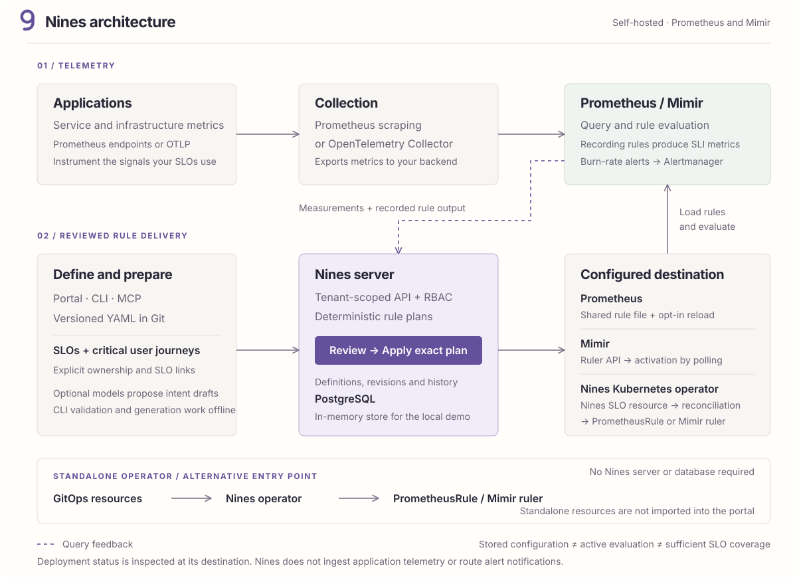

# Architecture

- Nines is a Go server with a React/shadcn/ui frontend embedded in the executable. PostgreSQL stores normal deployment data.
  - The explicit demo uses isolated memory stores and synthetic data.
  - Deploy one collecting server process for the MVP; distributed collector scheduling is not implemented.
- The CLI shares validation, deterministic measurement compilation and recording-rule generation with the server.
  - Offline commands do not start a server or load credentials.
  - Connected operations use a fixed server and tenant, with exact revisions or digests for writes.
  - The Go client and stdio MCP adapter use the same HTTP contracts.

| Path                                                            | Responsibility                                           |
| --------------------------------------------------------------- | -------------------------------------------------------- |
| `api/v1alpha1`                                                  | Shared versioned resource and operation types            |
| `internal/model`, `internal/engine`                             | Validation and SLI/SLO calculation                       |
| `internal/prometheus`, `internal/rules`                         | Provider queries, recording and burn-rate rules          |
| `internal/store`                                                | Memory/PostgreSQL resource and measurement storage       |
| `internal/tenancy`, `internal/identity`                         | Tenant boundaries, roles, sessions and provider identity |
| `internal/httpapi`                                              | Authenticated HTTP contracts and embedded UI             |
| `cmd/server`, `cmd/nines`, `cmd/mcp`                            | Server, Cobra CLI and stdio adapter                      |
| `client`, `skills`                                              | Go API client and bundled agent guidance                 |
| `web`                                                           | UI source, tests and build configuration                 |
| `internal/intentflow`, `internal/investigation`, `reviewskills` | Experimental bounded agent workflows                     |
| `internal/operator`, `cmd/operator`                             | Standalone Kubernetes controller and GitOps adapter      |

- The default resource is one self-contained SLO: `spec.measurement` owns its metric, population, success criteria, scrape cadence and observation point alongside the target, window and policies.
  - Deterministic compilation derives provider selectors without creating another resource.
  - The same contract works in portal, CLI, MCP and operator; intent workflows add human confirmation and reviewed changes.
  - Explicit shared bindings and custom queries remain advanced alternatives.
- Each tenant selects an independently bound store, source map and rule destination.
  - An owner can enable automatic rule reconciliation per source: saved SLO revisions, including approved intent apply and rollback, become the desired recording/alert rules.
  - Prometheus uses a shared rule directory plus native reload, Mimir uses its ruler API, and operator mode publishes owned SLO CRs.
  - Persistent pause/retry controls and separate runtime/output checks are described in [automatic rule deployment](deployment/automatic-rules.md).
  - User input does not select database schemas, arbitrary provider URLs, credentials or Mimir organizations.
  - Projects are metadata within a tenant, not independent security boundaries. Models cannot change the deterministic arithmetic.
- The Go module path is `github.com/ishantanu/nines`.
  - Public SDK installation becomes available after the repository and version are published.
  - The public source export is rooted in the platform alone; parent analysis files and other projects are excluded.
