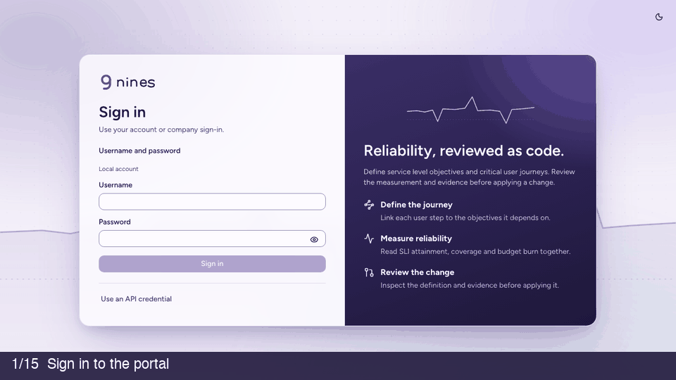
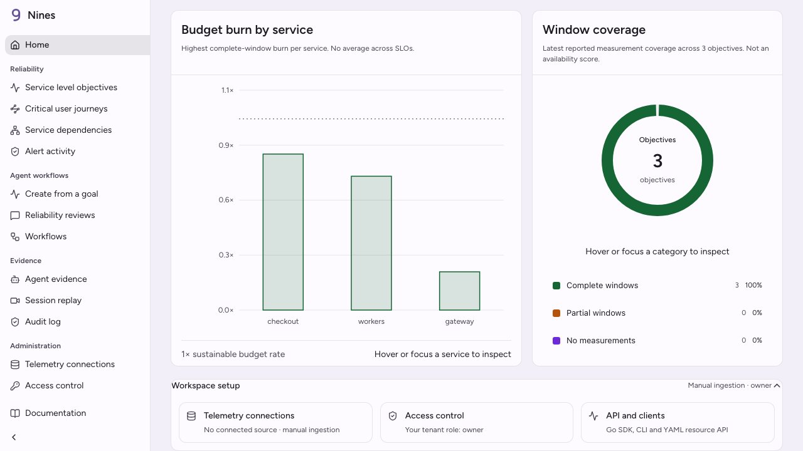

# SLO measurements

An SLO answers three questions: **what counts as success, how often it must succeed, and over what window**. Define these together in one `ServiceLevelObjective`.

- Its `spec.measurement` selects the metric and eligible events; the target, window and burn-rate policies describe the objective.
- A critical user journey links the SLOs that protect a user experience.
- There is no separate measurement to name, save or version in the default flow. Measurement edits create a new revision of the same SLO. [Previous revisions](slo-editing.md) retain their original definitions and collected evidence.

## Create an SLO in the portal



The recording uses the local playground's synthetic sample service and takes about 25 seconds. The steps below match it.

1. Open **Service level objectives → Define objective**.
2. Leave **SLO type** on **Availability**, or choose **Latency**, **Sessions** or **Good-minute**. **Start from a template** offers templates of the chosen type. See [SLO types](slo-types.md).
3. Enter a display name, the service and the metric. The identifier follows the display name, and **Advanced** holds the identifier, project and measurement and scrape intervals.
4. Select the events that count (population filters) and, for success rates, the label that marks a good event, or the latency threshold. State where events are observed and what that observation misses.
5. Set the target and rolling window. They default to 99.9% over 28 days. **Optional settings** hold the lifecycle, burn-rate alerts, labels, per-customer reports, error-budget response and quality requirements, and stay closed unless you set them. Only committed SLOs emit burn alerts; other lifecycles keep measuring.
6. Select **Verify telemetry and review SLO**. Nines checks recent metric metadata and observed series and generates one SLO YAML definition. Nothing is saved by this preview.
7. Review the exact definition, telemetry interval and warnings, acknowledge the measurement semantics, then select **Save reviewed SLO**.
8. The telemetry connection policy controls delivery: with **automatic deployment** enabled, saving queues its rules without another apply action. Otherwise use **Rules → Apply reviewed rules**. Inspect configuration and runtime evidence separately. See [automatic deployment](deployment/automatic-rules.md).

- Edit an existing structured measurement in the same **Measurement** tab.
  - The reviewed update keeps `metadata.name`, increments its revision and resets active measurement evidence when semantics change.
  - A manual edit through this form omits earlier intent provenance; earlier revisions retain it.
  - Use an intent conversation for a new agent-assisted proposal with fresh confirmation and approval.
- See [measurement quality](measurement-quality.md) for count/freshness requirements and cohort inspection, and [error-budget response policies](error-budget-policy.md) for operational decisions.

## Lifecycle and alert eligibility

- `spec.lifecycle` accepts `experimental`, `aspirational`, `committed` or `deprecated`. Omitting it preserves committed behavior. Choose experimental while validating instrumentation, aspirational for a target you are working toward, committed for an operational commitment, and deprecated while retiring an objective.
- All four lifecycles retain SLI measurements, error-budget arithmetic, history and recording rules.
  - Only committed generates burn alert rules and emits Nines burn events.
  - Noncommitted objectives display **Alerts disabled** instead of suggesting a successful alert evaluation. Lifecycle changes create ordinary reviewed revisions.
  - They preserve measurement evidence; a change of population, source or measurement semantics still starts fresh coverage.
  - Promoting to committed produces a review warning.
- A definition save does not instantly disable alerts in an external evaluator.
  - With automatic rule delivery, wait for the revised group to be loaded and evaluated.
  - In manual mode, apply the reviewed rules.
  - Until that succeeds, the previous Prometheus/Mimir group can still alert.
  - Nines does not manage existing Alertmanager notifications or silences.
- Each burn policy may set `minEvents` to a nonnegative count.
  - Both its short and long windows must contain at least this many eligible events, in addition to sufficient coverage and nonzero traffic.
  - Omit it or use zero for the existing behavior.
  - This is a traffic guard, not a statistical confidence interval; scrape-based counter increases can be fractional estimates.
  - Choose it from the service's traffic and response needs rather than copying a universal value.
- Each burn policy may also set `confidence` (0.5 to 0.9999) to make low-traffic alerts statistically cautious.
  - Each window must then show an error rate of at least `P + z * sqrt(P * (1 - P) / N)`, where `P` is the error rate the burn threshold represents, `N` is the events in that window and `z` is the two-tailed normal score for the confidence (about 2.576 at 0.99).
  - As traffic falls the threshold rises, so a handful of failures cannot page by chance. For a 14.4x burn on a 99% target at confidence 0.99, a window needs about 173 failures in 1,000 events, 42 in 200 and 24 in 100. With high traffic the extra term vanishes and the plain burn threshold applies.
  - Nines evaluation and the generated Prometheus and Mimir rules use the same formula. Omit it or use zero for the existing behavior.
  - It can delay or suppress an alert for a very low-traffic service, and it is a threshold rule, not a guarantee. It combines with `minEvents`, which still gates the minimum count.

For example, add these fields to the complete YAML below:

```yaml
spec:
  lifecycle: experimental
  policies:
    - name: fast-burn
      severity: critical
      shortWindow: 5m
      longWindow: 1h
      burnRate: 14.4
      for: 2m
      minEvents: 100
      confidence: 0.99
```

- This excerpt illustrates the optional fields; it is not a complete SLO.
  - Thresholds above `1 / (1 - target)` are rejected because even 100% failed events cannot reach them.
  - For a 90% target, the maximum burn rate is 10, so a copied 14.4 threshold would never fire.

The offline CLI accepts the same fields. For a single-policy starter:

```sh
nines init slo --name api --lifecycle experimental --min-events 100 --out api.slo.yaml
nines validate --offline -f api.slo.yaml
```

- Edit named `policies` in YAML; single-policy override flags deliberately reject ambiguous updates to a list. `--no-policy` removes either form. When an SLO retains intent provenance, its lifecycle and policy fields must agree with that reviewed intent.
- Historical burn crossings remain numerical previews even when lifecycle disables alerts.
  - In Nines, insufficient coverage or traffic interrupts pending and never establishes recovery of a firing episode.
  - Prometheus/Mimir use their native alert-state behavior: an absent alert expression can resolve an alert.
  - Validate external notification routing and missing-data monitoring separately.

## Classify objectives with labels

- Add `spec.labels` to group objectives by ownership or product, for example `team`, `feature_area` or `product`.
  - Use up to eight labels. A key is 1 to 32 lowercase letters, digits, dots, hyphens or underscores and starts with a letter. A value is 1 to 63 letters, digits, spaces, dots, slashes, hyphens or underscores and starts with a letter or digit.
  - Labels never change measurement, alert policies or generated rules, and they must not hold customer identifiers or secrets. Like any definition change, editing labels creates a new revision.
  - From the CLI: `nines init slo --name api --label team=payments --label product=Checkout`. The flag replaces existing labels.
- The portal's **Objectives** page can filter by label, and **Home** shows **Reliability by label**: active objectives grouped by one label, worst first.
  - The table counts degraded, at-risk, incomplete-evidence and healthy objectives and shows the lowest remaining budget. It does not combine them into one score, and an unmeasured budget stays unknown.
  - Objectives without the chosen label are counted separately, never folded into a value. Archived objectives are excluded.

## Measure sessions instead of requests

Client-side signals such as app crashes, error prompts or unresponsive screens have no natural request denominator, so an SLI built from raw events needs a threshold that must be retuned as usage changes. A session SLI counts the share of sessions that did **not** experience the event, so the denominator is always sessions.

```yaml
spec:
  measurement:
    type: sessions
    metric: app_sessions_total
    eventMetric: app_sessions_crashed_total
    labels:
      app: ios
    scrapeInterval: 15s
    observationPoint: One increment per app session; the event counter increments once per crashed session.
  target: 0.995
```

- `metric` is a counter incremented once per session. `eventMetric` is a counter incremented once per session that experienced the event, and both use the same `labels` population.
- The SLI is `(sessions - sessions with the event) / sessions` over each window. Burn rate, error budget and alert policies work as for any ratio SLO.
- Both counters must exist. If either is absent the result is **unknown**, never "no failures", so export the event counter at zero before its first event. Compilation and the measurement contract check verify that both are counters with series for the population.
- One session should increment the event counter at most once. Counting several events from one session makes the SLI meaningless, and Nines cannot detect that from counters. Choose events of comparable severity, because a "critical failure" cohort is easier to interpret than a mix.
- It needs a provider with whole-window counts and PromQL: Prometheus or Mimir in the portal, or Dash0 in YAML (accepted by validation, not run against a live Dash0 account). See the [provider table](slo-types.md#which-providers-support-which-types). In **Define objective**, choose **Sessions** under **SLO type**, or use YAML. Templates do not offer it. OpenSLO export, cohort inspection, per-customer reporting and failure concentration do not support session measurements yet and say so rather than returning partial results.

## Judge intervals instead of events

Some signals have a steady noise floor you cannot remove, such as client-side errors from poor networks or old devices. A plain event ratio then needs a very loose target, and a real incident can hide inside it. A good-interval SLO counts intervals instead.

- In the portal, choose **Good-minute** under **SLO type** in **Define objective**. It opens **Settings** with custom queries and the **Good-minute** section enabled, where you enter the error rate and the optional minimum events. In YAML, add `spec.intervals` to an SLO that uses `queries` interval counts on a PromQL source.
  - `errorRate` (above 0 and below 1) is the line an interval must stay under. An interval is **bad** when its error ratio exceeds it.
  - `minEvents` is optional. An interval with fewer events is not judged, and an interval with no events is never judged.
  - With a 60 second step each interval is a minute, so a target of 99.9% means 99.9% of judged minutes must be good.

```yaml
spec:
  target: 0.999
  window: 30d
  queries:
    good: sum(increase(client_requests_ok_total[1m]))
    total: sum(increase(client_requests_total[1m]))
  intervals:
    errorRate: 0.06
    minEvents: 20
```

- Place `errorRate` just above the noise floor you observe, so ordinary noise costs nothing and a genuine degradation spends budget. A steady 5% error rate meets a 99.9% good-minute target when `errorRate` is 0.06, which an event ratio could never do.
- Every judged interval weighs the same however busy it was: a quiet bad minute costs as much as a busy one. That suits noisy signals and differs from an event-weighted ratio, so prefer a plain ratio where traffic is steady and clean.
- Nines evaluation and the generated Prometheus and Mimir recording rules use the same definition, checked against a real evaluator. Burn rate, error budget and alert policies all work over judged intervals, so a policy's `minEvents` and `confidence` then count intervals, not events.
- Coverage is unchanged: every observed step counts, including idle ones. If no interval is judged the result is unknown, never perfect.
- It is not available with an inline `measurement`, a binding or an intent, whose windows the provider evaluates, and it supports PromQL sources only. Planning shows a notice that counts are intervals.

## One YAML definition

See the complete [availability SLO](../../examples/request-success.slo.yaml) and [latency SLO](../../examples/request-latency.slo.yaml), including two severity-based burn policies. For example:

```yaml
apiVersion: nines.dev/v1beta1
kind: ServiceLevelObjective
metadata:
  name: request-success
  project: production
spec:
  displayName: API request success
  service: api
  target: 0.999
  connection: primary
  measurement:
    type: availability
    metric: http_requests_total
    labels:
      environment: production
      service: api
    successLabels:
      status: "200"
    observationPoint: Completed API requests, including failures. Requests that never reach the server are not observed.
  policies:
    - name: fast-burn
      severity: critical
      shortWindow: 5m
      longWindow: 1h
      burnRate: 14.4
      for: 2m
    - name: sustained-burn
      severity: warning
      shortWindow: 30m
      longWindow: 6h
      burnRate: 6
      for: 5m
```

- The window (28 days), step (one minute) and scrape interval (15 seconds) are the defaults, so the file leaves them out. See [resource format](resource-format.md) for every default.
- `connection` names a tenant-configured connection, not a provider URL or credential; omitted, it is `primary`.
  - Label filters are exact string matches. `labels` selects all eligible events; `successLabels` adds the matches for good events.
  - Availability currently supports positive equality success criteria, not regex/negation.
  - Use custom queries when the measurement requires more expressive logic. `countFrom: histogram` selects a classic histogram's `_count` for event counting.
  - Latency uses the exact `threshold` bucket and `_count` total; missing buckets, quantiles and native histograms are rejected.
- `step` must be 1s–1h and divide the rolling window.
  - A rolling window may be at most 31 days and contain at most 100,000 intervals; 28 days with 60-second intervals is 40,320 intervals.
  - The positive scrape interval must satisfy the provider-window constraints.
  - Short/long burn windows must align with the measurement interval.
  - PromQL selectors and window calculations are generated deterministically; `measurement`, `queries` and `binding` are mutually exclusive.

## CLI, API and agents

```sh
# Offline validation and rule generation require no server or model.
nines validate --offline -f examples/request-success.slo.yaml
nines rules generate --offline -f examples/request-success.slo.yaml --tenant production

# Connected read-only verification against the tenant's configured source.
nines telemetry verify -f examples/request-success.slo.yaml --context production --agent

# Review and apply the same SLO. Zero means create; edits need the current revision.
nines plan -f examples/request-success.slo.yaml --context production --agent
nines apply -f examples/request-success.slo.yaml --expected-revision 0 --context production --agent
```

- `POST /api/slos/compile` accepts one versioned SLO as `application/yaml` or `application/json`.
  - It returns the unchanged self-contained manifest/YAML, compiler version, measurement digest, manifest digest, bounded telemetry evidence and warnings.
  - It writes no resource and creates no hidden binding.
  - The Go client exposes `CompileMeasurement`; MCP exposes read-only `verify_slo_measurement`.
- For intent workflows, put the same `measurement` and `stepSeconds` inside the [intent](../../examples/api-success.intent.yaml).
  - The deterministic planner verifies that its outcome, entire population and latency threshold match the goal.
  - In a conversation, an owner/editor confirms the exact `measurementDigest` and `intentDigest` at the current `expectedVersion`, then separately reviews and approves the frozen change-set digest before apply.
  - A model cannot confirm a measurement or approve/apply changes.
  - Editing the goal or measurement invalidates prior selection, evidence and approval. [Governance and rollback](intent-governance.md) remain explicit.
- The operator accepts the same inline measurement in SLOs and [intent CRs](../../examples/operator/intent.yaml).
  - It renders/reconciles without reading a binding CR.
  - Standalone Kubernetes RBAC and GitOps govern changes; server conversation approvals are not implicitly attached to arbitrary GitOps edits.

## Advanced and existing definitions

- Direct `queries` (and `queries.window` for whole-window selectors) remain available through Settings/YAML for advanced queries.
  - An explicitly authored legacy `MeasurementBinding` and revision-pinned reference remain accepted for existing shared contracts, but they are not a prerequisite and have no primary navigation entry.
  - Nothing silently creates or updates one during the default flow.
- Telemetry metadata and observed series verify instrument compatibility.
  - They do not prove business correctness, excluded requests, current traffic, complete historical coverage or end-to-end user success. Missing evidence remains unknown.
  - The observation point, retries and eligible-event semantics require human review.

## Reading observed SLI attainment

- The portal shows the measured SLI percentage next to the SLO target in objective lists, headers and linked-objective views.
  - For example, `99.950% SLI` with a `99.900% target` and `Partial window` means that the ratio is available but the full rolling window has not yet been observed.
  - The chart shows one **Measured SLI** series against the **SLO target**. It measures the rolling objective window.
  - Dashed segments mean that the window has incomplete history; solid segments have complete history.
  - Incomplete history is a qualification of that series, not a separate metric.
  - Interval SLI remains in the selected-interval details.
  - Coverage reports how much of that window contains measurements; newly created long-window SLOs can have valid ratios while history accumulates.
- `No SLI data` means usable measurements are missing. `No traffic` means samples were received but their total eligible-event count is zero, so no attainment percentage can be calculated.
  - Missing budget data is not displayed as an exhausted progress bar.
  - Alert state and recording-rule deployment are separate from measured attainment.
  - Showing partial measurements does not weaken alert coverage requirements or establish full-window compliance.

## Read measurements from a telemetry connection

- Nines reads existing application metrics through the configured Prometheus or Mimir query API.
  - The background collector runs every 15 seconds for SLOs with a source and saved measurement queries.
  - Nines is not a replacement for scraping applications or sending telemetry into those systems.
- Open an SLO and use **Source measurements → Read latest measurements** to collect a bounded recent range immediately.
  - The source, credentials and Mimir organization come from trusted server configuration.
  - The saved SLO defines the good/total selectors; the server chooses completed, step-aligned times with a one-step delay.
  - The recent range covers up to 15 minutes, or one step for larger steps, within the SLO window.
  - Collected values refresh attainment and charts; this operation does not deploy rules or edit the SLO.
- Use **Browse metrics in this source** to list up to 100 recent metric names, optionally narrowed by prefix.
  - Select a metric to inspect its observed labels.
  - The browser uses bounded 15-minute index lookups, so series presence alone does not prove fresh traffic or a valid success definition.
  - Browsing never substitutes a metric into your SLO.
  - Editors can open the existing edit/review flow after inspecting the evidence; viewers can browse but cannot collect or edit.
- If a connection works but the saved selectors match no data, the panel reports an empty result.
  - For example, the integration playground exports `playground_requests_total{code="200"}` and `playground_requests_total{code="500"}`.
  - An SLO querying `http_requests_total` will not measure that fixture.
  - Use the metric that actually represents your intended application and review its labels; do not substitute an unrelated metric merely to produce a percentage.

For a recent read from the CLI:

```sh
nines collect api-availability --recent --tenant production --agent
```

- The equivalent API call is `POST /api/slos/api-availability/collect` with `{"recent":true}`.
  - The existing explicit `from`/`to` body remains available for backfills. Do not combine the two modes.
  - Collection commits measurement data, requires an editor or owner, and still checks tenant authorization, CSRF for cookie sessions and measurement revision safety.
  - An empty successful query is not an attained SLO; zero-traffic samples also do not imply success.

### Chart time range

- Nines charts read retained Nines observations, not arbitrary historical queries against the telemetry provider. Retention is 24 hours or twice the SLO window, whichever is longer. Longer retention does not change the objective or burn-rate evaluation windows.
- A one-minute SLO can now chart up to 24 hours of retained observations. Existing data that was already pruned cannot be recovered by this change. The picker lists relative presets beside custom dates. Ranges outside retained history or shorter than a measurement interval are disabled; short demo windows also offer seconds/minutes presets. Custom UTC ranges must fit inside retained history.
- Increasing the objective window changes SLO semantics and does not recover previously discarded observations. Retained history accumulates through collection; older gaps remain unknown unless explicitly backfilled from an available provider. Waiting longer or increasing provider retention does not extend the configured chart limit.

### Overview charts



Synthetic demo workspace. The donut counts objectives by reported coverage, not service availability.

- Each visible SLO row has a short SLI trend from retained Nines history. At most six trends load, with about sixty points per request. Reads are tenant-scoped, canceled on navigation and do not query external telemetry providers. Missing observations break the line; partial rolling windows use dashed segments.
- **Budget burn by service** shows the highest complete-window SLO burn rate per service, limited to the six highest services. It does not average SLOs. Incomplete or unavailable values are excluded, and 1× describes sustainable budget consumption rather than an alert threshold.
- **Window coverage** counts objectives with complete windows, partial windows or no measurements. Its percentages describe the share of objectives in each group, not averaged SLI attainment or journey availability. Zero traffic and fresh telemetry are separate concerns from window coverage.
- The service burn chart shares the detail charts’ left-hand axis, readable labels, shared green series marks, dotted reference and tooltip treatment. Zero burn is a baseline marker, not a fabricated bar height. Bar and donut inspection support keyboard focus. Numerical values remain available as text; hover is not the only way to inspect the charts. Reduced-motion preferences disable chart transitions.

### Chart accessibility

- Hover or tap the chart to inspect a timestamped tooltip with measured values, coverage qualifications and the target or burn threshold. Press Escape to dismiss it. Keyboard focus and arrow keys expose the same details. Keyboard users can focus the chart directly; no separate time-point scrubber is required.
  - Arrow keys select adjacent observations; Home/End select the first/last, and Page Up/Down move through the range.
  - The chart announces the selected timestamp, measured value, incomplete-window coverage when applicable, and target. A compact readout shows the selected time and values; raw per-sample tables are not part of the chart interface. UTC is retained consistently with the date-range controls.
  - Burn-rate windows use different stroke patterns as well as color; below-target complete-window values use triangular markers.
- Chart labels and controls use theme-aware colors checked against [WCAG 2.2 contrast requirements](https://www.w3.org/TR/WCAG22/#contrast-minimum).
  - Panels grow with their text rather than clipping readouts.
  - Date/time fields, focus indicators and tables remain available for keyboard use.
  - Automated semantic checks and light/dark token-contrast tests cover these chart components; they do not establish conformance of every product screen or assistive-technology combination.

## Burn alert window durations

- In v1beta1 every duration uses positive whole-number `d`, `h`, `m`, `s` and `ms` components, such as `5m`, `1h30m` or `3d`. Fields other than `measurement.threshold` must come to whole seconds. Datetime strings, fractions and week units are rejected.
- In v1alpha1, policy `shortWindow` and `longWindow` take `h`, `m` and `s` components or `shortWindowSeconds` and `longWindowSeconds`, never both; other v1alpha1 durations are numeric seconds.
- Runtime JSON responses, stored policy values and deterministic calculations use numeric seconds.
- The CLI, API, MCP resource apply and Kubernetes operator use the same parser and policy constraints. Duration syntax does not change burn-rate thresholds, alignment requirements or evaluation behavior.

## Delayed scheduled collection

- Automatic collection follows its last successful source watermark when a polling round is delayed. Each request is capped at 300 intervals and the SLO retention boundary.
- Catch-up queries fetch actual telemetry; they do not turn gaps into zero errors or force an alert to recover.
- Longer outages and late telemetry outside the bounded overlap still require an explicit backfill. Manual connections remain manual.

The compact overview trend and the detailed SLI chart use the same measured SLI, semantic line color, target-aware vertical scale and dashed treatment for partial coverage. The overview shows the last 15 minutes at a bounded resolution; the detail page has a selectable range and resolution, so points can differ when those settings differ. The dotted reference is the SLO target. Missing history is never stretched to fill the chart.

Burn-rate alert policies are optional. Without a policy, the performance page still shows SLI and error budget history; it links to Configuration instead of showing an empty burn-rate chart. The overview's whole-objective-window budget burn is distinct from the selected policy's short and long burn windows. Adding a policy is an explicit definition change, not a side effect of viewing a chart.
