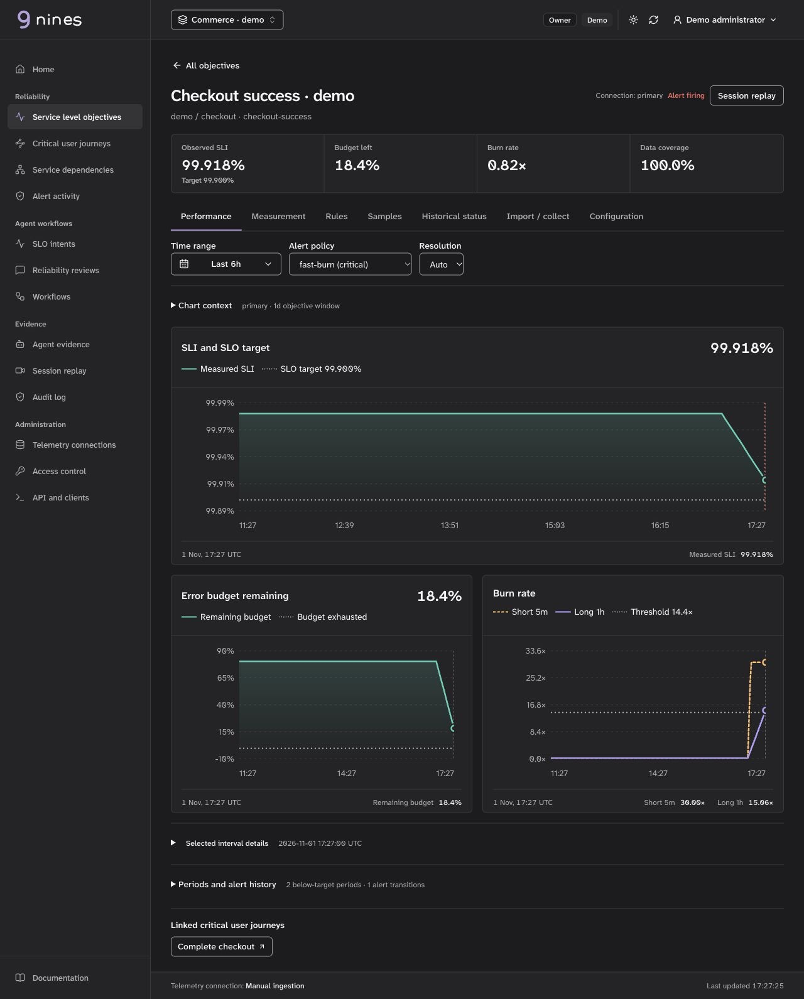

# How to define an SLO

A service level objective (SLO) sets a reliability target for a service over a stated window. A service level indicator (SLI) measures the user experience the objective describes. For an event-based SLI, divide the number of good eligible events by the total number of eligible events. A 99.9% SLO allows 0.1% bad eligible events in its window. It is not a promise that every individual user succeeds.

## Start with the user experience

1. Choose an outcome, such as successful checkout requests or responses completed within a latency threshold.
2. Define the eligible population, where events are observed, and which events count as good. Decide how retries, cancellations, timeouts and missing verdicts are treated.
3. Identify trustworthy metrics and verify that labels and event counts measure that population. Missing data and no traffic are not proof of success.
4. Select a target and rolling window based on user needs and historical evidence. A target is a policy choice, not a number an agent can infer safely on its own.
5. Use error budget consumption and burn rate to choose actionable alerts. Review the operational impact before paging.

## Availability example

This Nines definition measures the proportion of eligible `http_requests_total` events whose `status` label is `200`, over a rolling 28-day window. It includes illustrative burn-rate policies. Adapt the metric, labels and success criteria to your instrumentation: many APIs use multiple successful status codes, and requests that never reach this server are outside this observation point.

<!-- example: examples/request-success.slo.yaml -->

Use the [CLI reference](../cli.md) to validate the definition offline and generate recording rules. Connect a supported [telemetry provider](provider-adapters.md) to collect real measurements. Prometheus and Mimir support generated recording rules; native vendor publication has separate limits and review steps. Generation, rule deployment, rule evaluation and observed SLI are separate steps.

## Read SLI, budget and burn-rate charts

This is the synthetic checkout SLO in the local demo, not production telemetry. [Open the full-size screenshot](brand/nines-performance.jpg).

- **SLI and SLO target:** compare measured attainment with the configured objective. The value in the chart header follows the selected observation; it is not a separate measurement.
- **Error budget remaining:** see how much of the allowed failure budget remains. A negative value means the measured budget is exhausted.
- **Burn rate:** compare short- and long-window rates with the selected policy threshold. The example has a fast-burn alert firing even though full-window attainment remains above target.
- **Inspect history:** choose a preset or custom time range, then hover, tap or use the arrow keys on a focused chart. Read the timestamp and values together.
- **Check coverage:** missing data leaves gaps. Dashed SLI segments identify incomplete history and do not establish full-window attainment. Shading does not bridge gaps or cover incomplete SLI history.

Run `go run ./cmd/server -demo`, open `http://127.0.0.1:8080` and sign in with **admin / admin** to explore the charts with synthetic measurements. See [deployment options](deployment.md) before connecting a [telemetry provider](provider-adapters.md) for your own SLOs.

## Latency, journeys and AI workloads

- [Latency SLOs](latency-slos.md) explain how histogram bucket counts form the good and total event ratio. A latency threshold SLO is not automatically the same thing as a p95 or p99 chart.
- [Critical user journeys](critical-user-journeys.md) connect a user outcome and its steps to relevant SLOs. Linked service SLOs do not by themselves measure end-to-end journey success.
- [Agent, LLM and inference SLOs](agent-slos.md) cover logical task outcomes, evaluation coverage and serving latency. Define the rubric and missing-verdict policy before interpreting a pass rate.
- [SLI menus and templates](slo-templates.md) offer starting points that require instrumentation and target review.

## Using an agent

Nines can help draft an SLO with configurable models or deterministic templates. Confirm the population and success criteria against telemetry, inspect the proposal and evidence, and use the independent human approval and application workflow. A generated draft, successful validation or saved definition does not establish measurement quality, activated rules or a healthy SLI. See [SLO intents](intents.md) and [headless workflows](headless-workflows.md).
